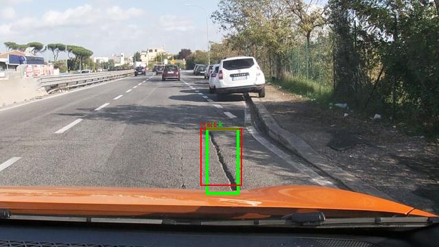
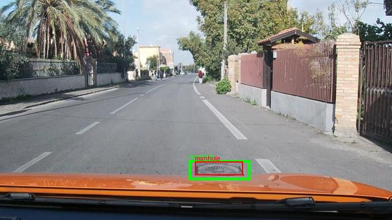
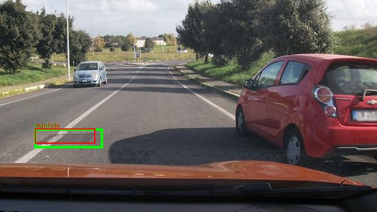
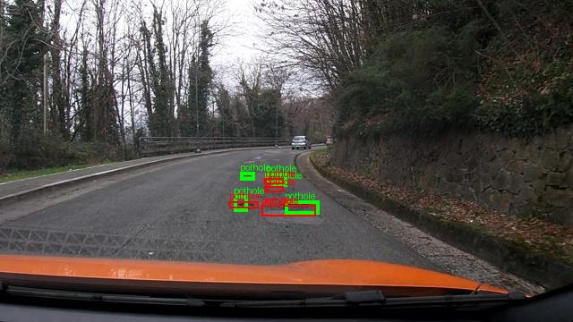
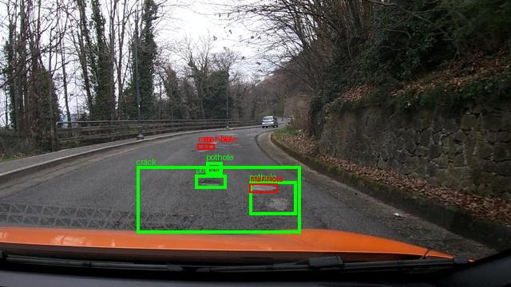
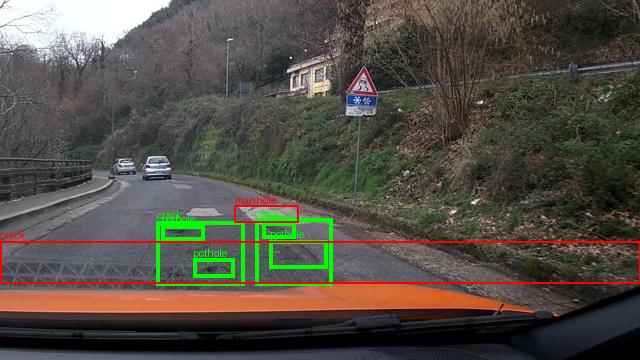

# E0 zero-shot: kết quả và lỗi đã quan sát

Đã chạy đủ 311 ảnh test. F1 = 0.10091743119266056, CI95 = [0.07272727272727272, 0.13079667063020212], parse_valid_rate = 0.8842443729903537. Có 44 TP, 245 FP, 539 FN. Chấm lại dự đoán thô trên máy bằng script gốc khớp mọi chỉ số; mean IoU khác 3×10⁻¹⁶ do thứ tự cộng số thực, không ảnh hưởng matching/F1/CI.

Các ảnh được chọn tất định theo FP+FN, rồi TP và image_id: ba ảnh ít lỗi nhất và ba ảnh nhiều lỗi nhất. GT xanh lá, dự đoán đỏ. Manifest chứa output thô và matching từng lớp tại [e0_manifest.json](figures/predictions/e0_manifest.json).

Ảnh `vlcsnap-2025-02-18-23h08m25s146`: 1 TP, 0 FP, 0 FN.

Ảnh `vlcsnap-2025-02-18-23h11m35s391`: 1 TP, 0 FP, 0 FN.

Ảnh `vlcsnap-2025-02-18-23h14m30s019`: 1 TP, 0 FP, 0 FN.

Ảnh `vlcsnap-2025-02-19-17h03m28s017`: GT có 5 pothole. Mô hình trả về 4 pothole và 1 manhole nhưng không box nào khớp đúng lớp với IoU≥0.5: 0 TP, 5 FP, 5 FN. Các box đỏ lệch vị trí/kích thước so với box xanh, nhất là những ổ gà nhỏ phía xa. Có một pothole và một manhole dùng cùng tọa độ [457,638,550,670], thể hiện dự đoán lớp không nhất quán tại cùng vùng.

Ảnh `vlcsnap-2025-02-19-17h03m29s526`: GT có 3 pothole và 1 crack, trong khi mô hình sinh 4 manhole. Box [489,640,543,670] bị lặp nguyên vẹn. Kết quả 0 TP, 4 FP, 4 FN. JSON parse được không bảo đảm nhãn đúng hay không bị lặp; lỗi này cần SFT học cả phân biệt lớp lẫn cấu trúc danh sách đối tượng.

Ảnh `vlcsnap-2025-02-19-17h03m02s980`: 0 TP, 2 FP, 6 FN. Box crack phủ toàn chiều rộng [0,670,1000,787] không khớp hai crack GT. Output còn có hai khóa bbox_2d trong cùng một đối tượng manhole; parser Python giữ giá trị cuối. Vì scorer vẫn parse output này, chỉ nhìn parse_valid_rate sẽ bỏ qua một lỗi cấu trúc đáng chú ý.

Đây là quan sát trên output và nhãn cụ thể, chưa chứng minh nguyên nhân bên trong mô hình. Các ảnh gần nhau trong cùng session có cảnh đường gần giống nhau; split theo session giữ cả phiên này trong test.
